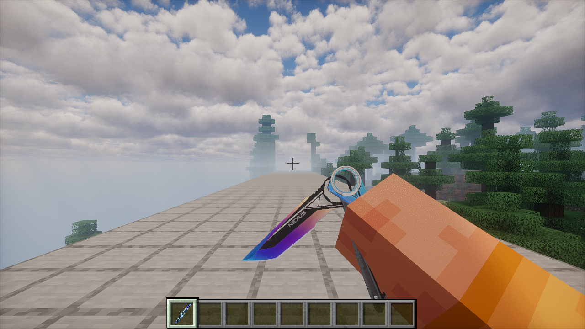
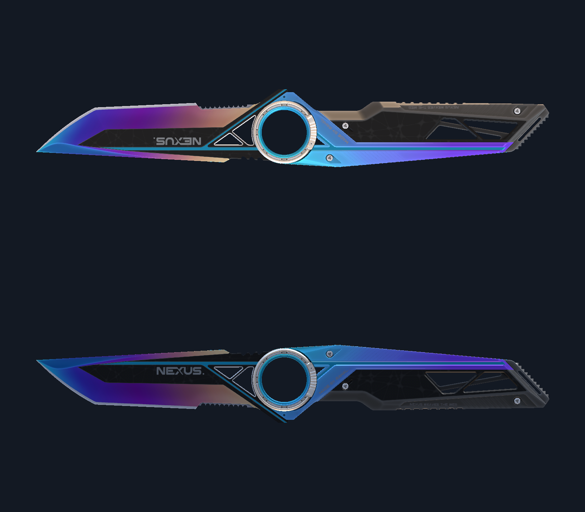
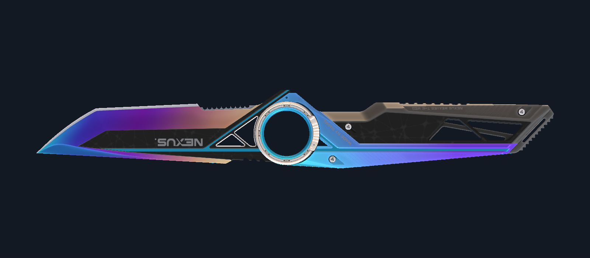
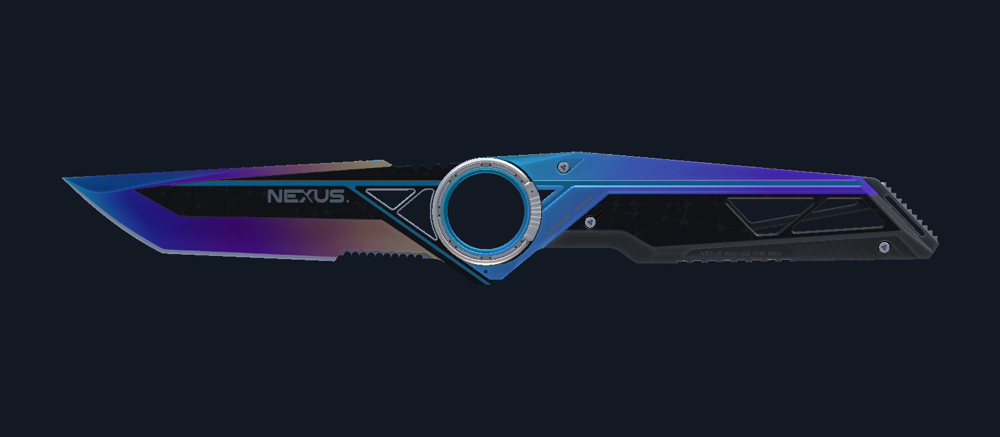
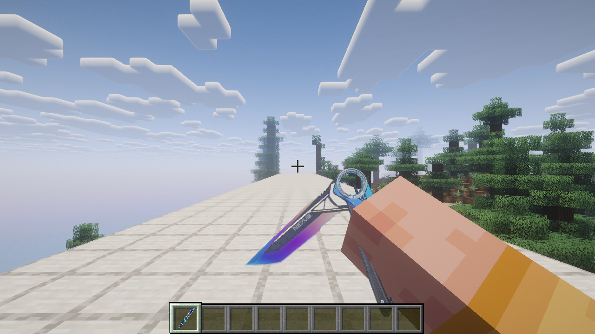

# 三角洲 · 重塑 (Delta Reshaper)

非官方粉丝重制作品：以《三角洲行动》中的刀械外观与动效为参考，为 Minecraft 制作的近战武器。

**当前版本：1.3.0 — 原始资源升级。** [下载最新版](https://github.com/xiazhiaidao/delta-reshaper/releases/latest) · Minecraft 1.20.1 / Forge。

> **非官方作品声明**
> 本项目为粉丝重制（unofficial fan recreation），与《三角洲行动》(Delta Force) 及其权利方
> 无任何隶属关系，亦未获其授权。"三角洲行动"、"Delta Force" 及相关名称、角色、标志的
> 著作权与商标权归其各自权利方所有。

---

## 来源声明

本作品参考《三角洲行动》中的武器外观、动作结构与音效制作。相关名称、角色、造型、贴图与音效的
著作权归原权利方所有，本作品不主张任何相关权利，亦未获授权。

本项目**免费发布，不收费、不接商业合作**。若任何权利方认为本作品侵犯其权益，请联系作者，
作者将立即停止分发并移除相关内容。

---

## 特性

| 模块 | 内容 |
|---|---|
| 模型 | 10,213 顶点 / 12,896 三角形蒙皮网格，按材质分区，保留转刀枢轴与原始 UV；不再是方块堆叠 |
| 材质 | 普通渲染用原始法线与 ORM 做环境反射，握柄区域独立哑光；光影走标准实体渲染与 LabPBR |
| 动画 | 16 个运行时动作：两套拔刀、三段攻击、13.67 秒完整检视、3.67 秒待机、2.13 秒奔跑与过渡轨道 |
| 音效 | 9 类事件、42 个音频变体，按动画通知时点播放；检视流式播放，打断或重载即停止 |

---

## 安装

### 依赖（必须）

| 依赖 | 版本 |
|---|---|
| Minecraft | 1.20.1 |
| Forge | 47+ |
| [TaCZ](https://modrinth.com/mod/tacz) (Timeless and Classics Zero) | ≥ 1.1.7（1.3.0 实测 1.1.8） |
| LR Tactical | ≥ 0.4.3 |

### 步骤

1. 安装 Forge 1.20.1
2. 把 TaCZ、LR Tactical 放进 `mods/`
3. 从 [Releases](https://github.com/xiazhiaidao/delta-reshaper/releases/latest) 下载 `delta-reshaper-1.3.0-original-forge-1.20.1.jar`，放进 `mods/`
4. **升级时移除旧版重塑 JAR** —— 1.3.0 与 1.2.x 的 mod ID 相同，只能启用其中一个
5. 启动游戏

**客户端与服务端都必须安装**：客户端提供模型、贴图、音效与着色器，服务端注册合成配方与武器定义。

---

## 1.3.0 更新内容

- **换成原始蒙皮网格**：由方块重建改为 10,213 顶点 / 12,896 三角形，按材质划分只保留各区域引用的顶点，不做三角简化；保留转刀枢轴与原始 UV。
- **完整动作集**：两种拔刀、三段攻击、13.6667 秒检视、3.6667 秒待机、2.1333 秒奔跑，共 16 个运行时动作；镜头、身体与武器轨道按源骨架配对，四元数采样保留原始转刀旋转。
- **原始音效**：9 个事件、42 个变体，按动画通知时点触发；检视流式播放，打断和资源重载会停掉所属音效。
- **掌端适配**：转刀与检视按原始指尖位置适配方块手末端，平滑进出；刀与手腕旋转保持不变。
- **修疾跑残留**：修复前的进度跳变实测约 3.79 倍速，修复后 1.0005 倍，实测循环 2.137 秒（源时长 2.133 秒）。
- **去塑料感**：普通渲染补上原始法线，金属区域降低漫反射，按粗糙度与拉丝方向计算高光；握柄继续用独立材质。
- **性能**：源网格直接渲染，渲染缓冲复用，去掉每方块六面的开销。
- **重载恢复**：重载替换显示资源后按 LR 原生初始化语义恢复上下文，不需要重新装备才恢复动作。

细节见 [docs/CHANGELOG-1.3.0.md](docs/CHANGELOG-1.3.0.md)。

---

## 光影兼容

支持 Oculus 光影兼容。采用标准渲染与 LabPBR 材质，兼容范围不限定光影名称；其他光影仍需按其实现验证，**不保证所有光影通用**。

实测环境：Minecraft 1.20.1、Forge 47.4.13、Oculus 1.8.0。

| 光影 | 必要设置 | 已验证范围 |
|---|---|---|
| Complementary Reimagined r5.9.3 | 材质模式 LabPBR（`RP_MODE=3`），关闭 POM | 金属/粗糙度材质、检视线光、开关光影、第一人称双手 |
| Photon v1.3b | 开启 Normal Mapping / Specular Mapping，关闭 POM | 金属材质、检视线光、第一人称双手 |
| Sildur’s Vibrant v1.51 Extreme-VL | 默认设置 | 完整基础外观和检视线光；此版本不读取本刀 LabPBR 金属通道 |

- 显示异常时按 **F8 → 光影材质 → 基础（关闭附加效果）**，关闭额外 PBR 和发光叠层。
- 开光影时反射由光影选项控制，F8 的无光影反射滑块暂不生效；不开光影仍保留原有自定义效果。
- 仅替换 JAR 不会替你调整光影选项，需要按上表手动开启。
- 光影下使用独立即时绘制批次，修复了共享世界缓冲导致第一人称模型消失的问题。
- Derivative 25.0.1 与当前 Oculus 1.8.0 不兼容：光影请求 31 号渲染目标，而加载器只支持 16 个。移除本 mod 后也能重现。

[详细设置、测试范围与已知限制](docs/SHADER_COMPATIBILITY.md)

---

## 预览

| 正面 | 背面 |
|---|---|
|  |  |

Complementary Reimagined 实机：

### 🎬 对比视频（1.2.0 时期录制）

[▶ 点击观看对比视频](https://github.com/xiazhiaidao/delta-reshaper/releases/download/v1.2.0/full-source-comparison.mp4)

原视频（左）/ 实机（右）· 23.5 秒原速 · 双声道 · 2560×792

也可以在仓库里直接播放：[preview/full-source-comparison.mp4](preview/full-source-comparison.mp4)

---

## 版本

| 版本 | 说明 |
|---|---|
| 1.3.0 | 原始蒙皮网格、16 段动作、原始音效、疾跑时钟修复、重载恢复 |
| 1.2.1 | 光影原生材质、F8 基础回退、Photon 发光透明修复与重载防崩溃 |
| 1.2.0 | 首次公开发布 |

---

## 许可

**All Rights Reserved.** 详见 [LICENSE.txt](LICENSE.txt)。

简而言之：

- ✅ 允许：以未修改的 jar 安装使用；在不额外收费的前提下收录进整合包
- ❌ 禁止：反编译、修改、再分发改版；提取模型/贴图/材质/着色器/动画/音效挪作他用；任何商业使用

---

## 已知限制

- Minecraft 的方块手臂没有手指关节，握点按原始指尖位置适配，指部细节无法逐根对应
- 原作的程序材质与运行时材质曲线没有完整复现，检视青光与反射是面向 Minecraft 的适配实现
- 第三人称人物动作未转接，掉落与展示框使用刀体网格加原版持握变换
- 若权利方认为本作品侵犯其权益，将立即停止分发并移除相关内容
