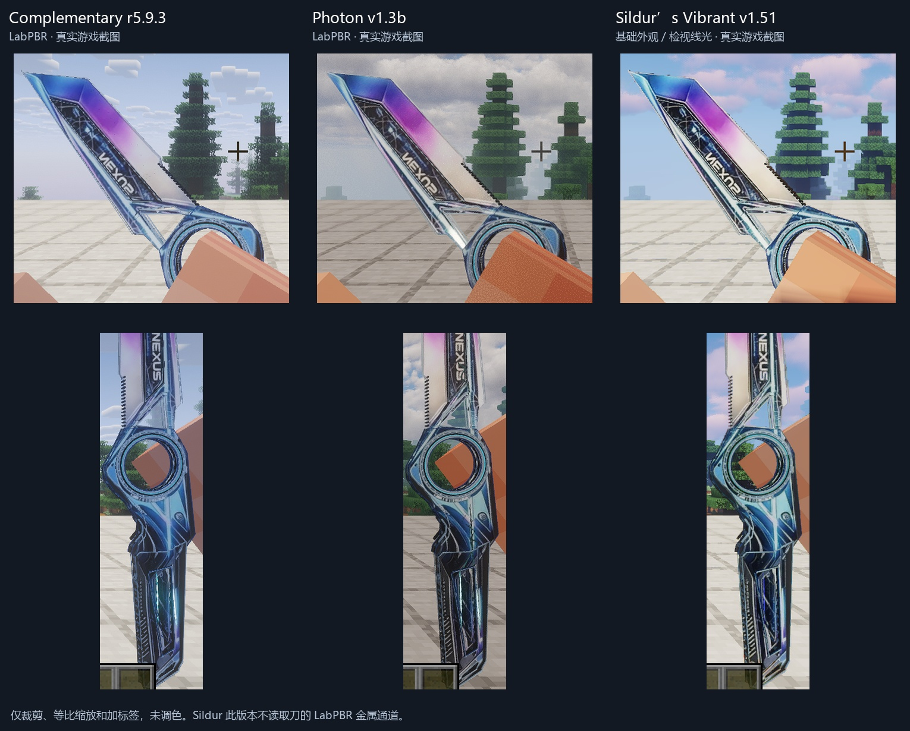
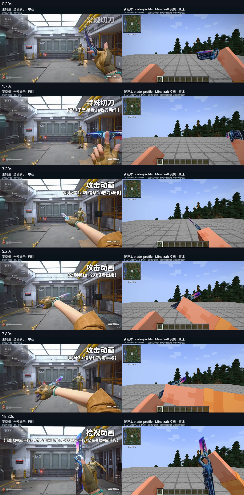

# 三角洲 · 重塑 (Delta Reshaper)

非官方粉丝重制作品：参考《三角洲行动》的刀械外观与动效，为 Minecraft 制作的近战武器。

**当前版本：1.2.1 — 光影兼容更新。** [下载最新版](https://github.com/xiazhiaidao/delta-reshaper/releases/latest) · Minecraft 1.20.1 / Forge。

> **非官方作品声明**
> 本项目为粉丝重制（unofficial fan recreation），与《三角洲行动》(Delta Force) 及其权利方
> 无任何隶属关系，亦未获其授权。"三角洲行动"、"Delta Force" 及相关名称、角色、标志的
> 著作权与商标权归其各自权利方所有。

---

## 来源声明

本项目在制作过程中参考了以下第三方内容：

| 用途 | 来源 |
|---|---|
| 动作参考 / 音效提取 / 对比视频左半 | 抖音 [@哲儿都能行](https://v.douyin.com/Y7uGMCnyV1k/) —《20秒看懂新刀皮》 |

- 原视频标题：《20秒看懂新刀皮》
- 原视频链接：https://v.douyin.com/Y7uGMCnyV1k/
- 话题：#三角洲检视动作 #三角洲剪辑
- 原视频版权归其作者所有。本项目仅以该视频作为动作结构与音效的参考，
  不代表原作者认可或参与本项目。

---

## 特性

| 模块 | 内容 |
|---|---|
| 模型 | 参考原刀重新描摹，分层金属几何：斜切刀脊、填充刃口、连续金属侧 UV |
| 材质 | 无光影使用自定义虹光与刀刃反射；光影模式使用原生渲染和 LabPBR 材质，刀把保持独立哑光 |
| 动画 | 两套切刀（常规 / 特殊）、三段攻击、13.3 秒完整检视 |
| 音效 | 从参考演示视频音轨提取并匹配原动作时间点 |

---

## 安装

### 依赖（必须）

| 依赖 | 版本 |
|---|---|
| Minecraft | 1.20.1 |
| Forge | 47+ |
| [TaCZ](https://modrinth.com/mod/tacz) (Timeless and Classics Zero) | ≥ 1.1.7 |
| LR Tactical | ≥ 0.4.3 |

### 步骤

1. 安装 Forge 1.20.1
2. 把 TaCZ、LR Tactical 放进 `mods/`
3. 从 [Releases](https://github.com/xiazhiaidao/delta-reshaper/releases/latest) 下载 `delta-reshaper-1.2.1-forge-1.20.1.jar`，放进 `mods/`；升级时移除旧版重塑 JAR，避免重复安装
4. 启动游戏

**客户端与服务端都必须安装**：客户端提供模型、贴图、音效与着色器，服务端注册合成配方与武器定义。

---

## 光影兼容（1.2.1）

支持 Oculus 光影兼容。采用标准渲染与 LabPBR 材质，兼容范围不限定光影名称；其他光影仍需按其实现验证，**不保证所有光影通用**。

实测环境：Minecraft 1.20.1、Forge 47.4.13、Oculus 1.8.0。

| 光影 | 必要设置 | 已验证范围 |
|---|---|---|
| Complementary Reimagined r5.9.3 | 材质模式 LabPBR（`RP_MODE=3`），关闭 POM | 金属/粗糙度材质、检视线光、开关光影 |
| Photon v1.3b | 开启 Normal Mapping / Specular Mapping，关闭 POM | 金属材质、检视线光；修复发光时整刀盖黑 |
| Sildur’s Vibrant v1.51 Extreme-VL | 默认设置 | 完整基础外观和检视线光；此版本不读取本刀 LabPBR 金属通道 |

- 显示异常时按 **F8 → 光影材质 → 基础（关闭附加效果）**，关闭额外 PBR 和发光叠层。
- 开光影时反射由光影选项控制，F8 的无光影反射滑块暂不生效；不开光影仍保留原有自定义效果。
- 仅替换 JAR 不会替你调整光影选项，需要按上表手动开启。切换全局材质模式也可能改变其他方块的外观。
- Derivative 25.0.1 与当前 Oculus 1.8.0 不兼容：光影请求 31 号渲染目标，而加载器只支持 16 个。移除本 mod 后也能重现。
- 已防止 F3+T 重载时空动画上下文导致的崩溃；重载后动画上下文自动恢复仍未解决，必要时重进游戏。

[详细设置、测试范围与已知限制](docs/SHADER_COMPATIBILITY.md)

---

## 预览

### 🎬 [▶ 点击观看对比视频](https://github.com/xiazhiaidao/delta-reshaper/releases/download/v1.2.0/full-source-comparison.mp4)

原视频（左）/ 实机（右）· 23.5 秒原速 · 双声道 · 2560×792

也可以在仓库里直接播放：[preview/full-source-comparison.mp4](preview/full-source-comparison.mp4)

### 抽帧核对

---

## 版本

| 版本 | 说明 |
|---|---|
| 1.2.1 | 光影原生材质、F8 基础回退、Photon 发光透明修复与重载防崩溃 |
| 1.2.0 | 首次公开发布 |

---

## 许可

**All Rights Reserved.** 详见 [LICENSE.txt](LICENSE.txt)。

简而言之：

- ✅ 允许：以未修改的 jar 安装使用；在不额外收费的前提下收录进整合包
- ❌ 禁止：反编译、修改、再分发改版；提取模型/贴图/材质/着色器/动画/音效挪作他用；任何商业使用

---

## 已知限制

- Minecraft 的方块手臂没有手指关节，无法还原原片的手腕与指部动作
- 单视角深度估计导致部分姿态与原片存在偏差
- 若权利方认为本作品侵犯其权益，将立即停止分发并移除相关内容
